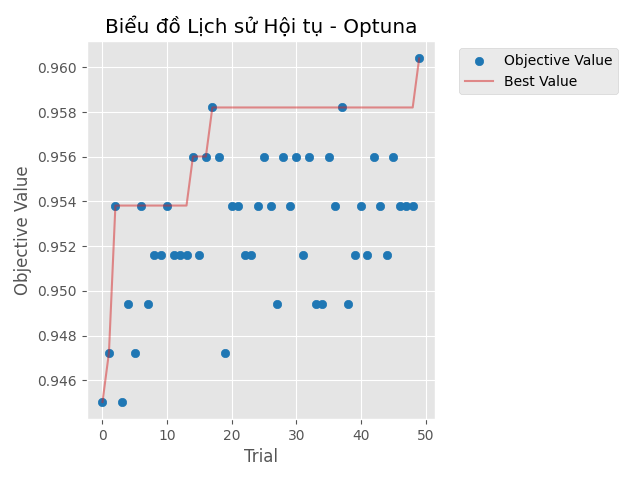

# Tối ưu hóa siêu tham số Random Forest bằng Optuna

## 1. Problem Statement
Dự án nhằm mục tiêu phân loại ung thư vú (Breast Cancer) bằng mô hình Machine Learning. Vấn đề cốt lõi là làm sao tìm ra bộ siêu tham số (hyperparameters) tốt nhất cho mô hình Random Forest để đạt độ chính xác cao nhất mà không phải thử thủ công.

## 2. Optimization Formulation
*   **Biến quyết định (Decision Variables - $x$):** 
    * `n_estimators`: [số lượng cây, ví dụ 10-100]
    * `max_depth`: [độ sâu tối đa, ví dụ 2-32]
    * `min_samples_split`: [số mẫu tối thiểu để chia, ví dụ 2-10]
    * `min_samples_leaf`: [số mẫu tối thiểu ở lá, ví dụ 1-10]
*   **Hàm mục tiêu (Objective Function - $f(x)$):** Maximize Validation Accuracy (Tối đa hóa độ chính xác trên tập validation).
*   **Ràng buộc / Budget:** Giới hạn số lần thử (trials) là 50 lần chạy của Optuna.

## 3. Dataset
*   Sử dụng tập dữ liệu **Breast Cancer Wisconsin** (từ thư viện `scikit-learn` datasets).

## 4. Method
*   **Baseline:** Mô hình Random Forest với các tham số mặc định của scikit-learn.
*   **Phương pháp tối ưu chính:** Sử dụng thư viện **Optuna** để tìm kiếm siêu tham số tối ưu (Hyperparameter Optimization) tự động.

## 5. Key Results
*   **Cấu hình tốt nhất tìm được:** `n_estimators`: 77, `max_depth`: 19, `min_samples_split`: 2, `min_samples_leaf`: 2.
*   **Độ chính xác (Validation Accuracy):** Đạt 0.9582 (~95.82%).
*   *Biểu đồ lịch sử hội tụ:*

## 6. How to Run
Cài đặt thư viện:
`pip install -r requirements.txt`

Chạy file chính:
`python notebooks/import_optuna.py`

## 7. Repository Structure
- `notebooks/`: Chứa mã nguồn thực nghiệm (`import optuna.py`).
- `results/`: Chứa file lưu lịch sử chạy (`optuna_history.csv`).
- `figures/`: Chứa biểu đồ kết quả (`optimization_history.png`).
- `report/`: Chứa báo cáo PDF và slide thuyết trình.

## 8. Limitations
(Tự thêm 1-2 câu về hạn chế: ví dụ như không gian tìm kiếm còn nhỏ, chưa thử nghiệm trên các mô hình phức tạp hơn).